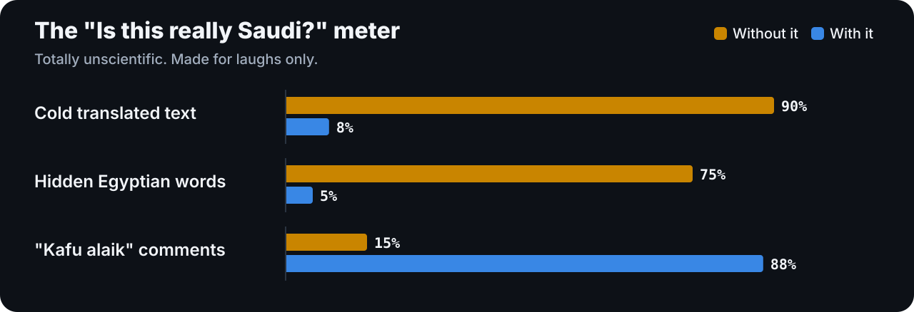

<p align="center"><b>English</b> · <a href="README.ar.md">العربية</a></p>

<p align="center"></p>

> **Saudi content that sounds truly local.** Writes, edits and audits Arabic content for Saudi audiences in white dialect or regional dialects: Najdi, Hijazi, Eastern, Northern and Southern. It works for social posts, ads, scripts and landing pages.

## How it works

<p align="center"></p>

## Just say it

- "Write an ad in white Saudi dialect"
- "Rewrite this text in Hijazi dialect"

## The results (joking, but also not really)

<p align="center"></p>

## Install in a minute

| You use | How to install |
|---|---|
| A Claude or ChatGPT account | Download [`saudi-dialect-content.zip`](https://github.com/Marsadgrouplabs/saudi-dialect-content/releases/latest/download/saudi-dialect-content.zip) and upload it under Skills |
| Claude Code | `claude plugin marketplace add Marsadgrouplabs/saudi-dialect-content` |
| Claude Code or Codex with a script | Clone the repo and run `install.ps1` or `install.sh` |

<details>
<summary><b>Step-by-step instructions</b></summary>

### Claude or ChatGPT account

1. Download [`saudi-dialect-content.zip`](https://github.com/Marsadgrouplabs/saudi-dialect-content/releases/latest/download/saudi-dialect-content.zip) and keep it zipped.
2. **Claude:** open Skills in your account and choose to upload a file.
3. **ChatGPT:** open Skills, then Create, then Upload from your computer. Availability depends on your plan.

### Claude Code plugin

```bash
claude plugin marketplace add Marsadgrouplabs/saudi-dialect-content
claude plugin install saudi-dialect-content@marsad-saudi-dialect-content
```

### Windows

```powershell
git clone https://github.com/Marsadgrouplabs/saudi-dialect-content.git
cd saudi-dialect-content
powershell -ExecutionPolicy Bypass -File .\install.ps1
```

### macOS or Linux

```bash
git clone https://github.com/Marsadgrouplabs/saudi-dialect-content.git
cd saudi-dialect-content
bash install.sh
```

The script installs to `~/.claude/skills` for Claude Code and `~/.agents/skills` for Codex, and keeps a backup of any older copy.

</details>

## Who publishes this, and where does your data go?

Published by **[Marsad Labs](https://labs.marsadgroup.co)**. Marsad Labs is the product arm of Marsad Group, a UK-registered marketing agency, and builds practical tools for marketers and developers. [About us](https://labs.marsadgroup.co/about-us/) · [Privacy policy](https://labs.marsadgroup.co/privacy-policy/)

| Question | Answer |
|---|---|
| **What does it read?** | The text or idea you give it. |
| **What does it connect to?** | All work happens inside the AI tool you are using. |
| **Does it need API keys?** | No. |
| **Code** | Text instructions and references only, with no scripts that run on your machine. |

This version was scanned with SkillSpector, its critical and high alerts were reviewed by hand, and client data and keys were removed. The full result, how to verify the file and how to report a problem are in [`SECURITY.md`](SECURITY.md).

## What you need

- No special requirements.

## Rights

All rights reserved by Marsad Labs. Copying or redistribution without permission is not allowed.

---

<p align="center">Made with love and far too much tea at <a href="https://labs.marsadgroup.co"><b>Marsad Labs</b></a></p>
